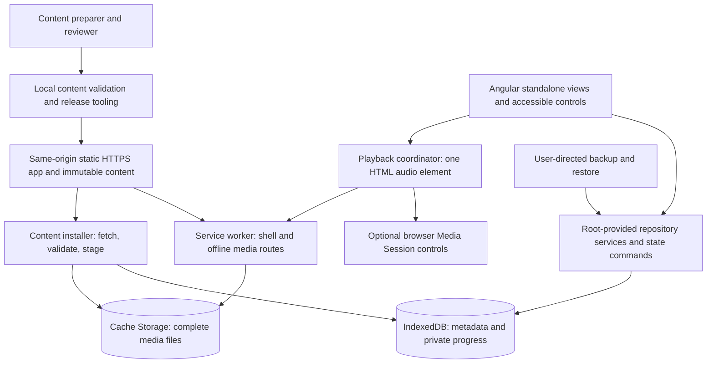

# ShrutDhara — web application design

Draft 0.4 · 2026-11-21 · Design only, no production implementation or publication

Implementation status lives in the [local verification report](implementation-checks.md). The `web/` Angular development build now runs alongside the original prototype. Firefox Android on the owner's CMF Phone 1 is the primary target, with Chrome Android also required.

Revision 0.5 (2026-11-21): introduced a `Recording` (ordered parts, validated manifest) so one player, offline installer and media session serve the real narration; the tone fixture is a second Recording. Policy change from 0.4: a recording of kind narration may stream when not saved (the service worker falls through to the network), but Driving mode and the fixture still require every part saved and verified. Saved listening position is still a single record keyed by recording id; a position saved against another recording is never reused. Per-recording positions are deferred and are required before other audio (for example the catalogue introductions) can share the player without overwriting this position.

Revision 0.4: implemented the authorized design-review recommendations. Bounded the first release, added an executable validation plan, simplified cross-window ownership, specified restore/update recovery, bounded media retention, moved backup into the first usable increment, and selected Vercel static hosting. These are design changes, not executed production or device evidence.

Revision 0.3: evaluated browser SQLite following the owner's request and delegated the storage choice to engineering. Retain IndexedDB for the first implementation, for the reasons below. No persistence implementation or comparative benchmark has been executed.

Revision 0.2: owner selected Angular in place of the earlier React proposal (D-03). Updated UI state, service lifetimes, build tooling, service-worker integration, and implementation slices. Behavioral and device-validation gates remain open.

## Recommendation and decision standing

Build a **static, installable progressive web app (PWA)**, with **Angular + TypeScript**, standalone components, signals, root-provided application services, IndexedDB for content metadata and personal state, a persistent HTML audio player, and a custom Workbox service worker for offline assets and range-aware audio. Use Angular CLI for builds. Host application and content on one stable HTTPS origin. No required application backend, account system, cloud database, paid API, APK, or store listing.

Web-only delivery is the owner's confirmed D-02 decision. Android phones remain the primary audience (D-01), and Angular is the confirmed framework choice (D-03). The detailed mechanisms below remain design recommendations where not otherwise accepted. The prior native Kotlin/Compose recommendation and React/Vite proposal are superseded.

Installable web apps do not require us to distribute a custom executable or publish a store package; installation remains browser/platform dependent. The app must also work through a normal URL without installation. [Web platform installation guidance](https://web.dev/learn/pwa/installation).

The decision-changing uncertainty is **real mobile-web listening**, not component rendering. Before building the whole app, prove actual offline audio, seeking, screen-off continuation, and media controls on intended Android phones. A PWA manifest and a simulated player do not prove these guarantees. If the selected browser fails the listening acceptance gate, stop dependent listening investment and bring back the precise failed condition; do not silently substitute native delivery or weaken the requirement.

## Inputs, current system, and scope

Behavioral authority: [use-case specification](use-case-specification.md), including its single gap/decision register and rules R-01–06. Rationale: [analysis findings](analysis-findings.md). Reusable visual direction and bounded browser evidence: [prototype review](prototype-review.md). Planned execution and pass/fail oracles: [web validation plan](web-validation-plan.md).

Current implementation is the disposable `prototype/` HTML/CSS/JS application, served by `prototype/server.mjs`. `prototype/state.mjs` validates demonstration state; `prototype/app.js` uses localStorage and a simulated timeline. There is no real narration, service worker, PWA installation, production content repository, or IndexedDB store. Its five state tests and browser observations cannot verify the proposed components. Retain the prototype for comparison; do not treat its DEMO identifiers or browser-local backup format as scripture identity or production persistence.

Preserve the paper/olive/saffron palette, Mukta interface font, Noto Serif Devanagari reading default, Hindi content, and balanced English utility labels. Reuse licensed local font files and notices. Reader gesture behavior, first chapter/source, review authority, and licensing decisions remain in G-02/03/04/09. The design does not close them.

### First release boundary

The selected implementation baseline is one complete reviewed chapter from one source edition, shared by reading and listening. It includes sources/component availability, independent resume, bookmarks, adjustable reading presentation, playback/seek/rate, explicit offline preparation, a prepared sequence of that chapter's recording parts, and backup export/restore. If a narration has one part, the prepared sequence has one entry. Playback stops when the selected chapter ends; missing chapters are never crossed automatically. Interrupted/disconnected playback remains paused until the user resumes. First-release controls expose only capabilities that pass the declared browser/device gate.

At most one app window may own study mutations and playback. Other windows may browse the catalog and show who owns the session; they do not maintain a second active journey. Section "Session ownership and maintenance protocol" defines the mechanism and recovery.

First online access obtains the app/content. Offline readiness requires successful local preparation; installation alone is not readiness. Backup/restore must pass before the first daily-use release. P1 and P2 below are development increments, not separately approved daily-use releases.

Deferred: an editable multi-chapter queue, chapter-completion judgments, topic search, arbitrary-edition mapping, automatic incompatible-recording migration, a general content management UI, and bulk audio distribution. The data model retains stable IDs, source/revision evidence, and unresolved-reference snapshots now; advanced mapping is triggered by the first actual incompatible correction. The 32-Agama goal remains in the specification. Reading swipe-versus-button behavior and authenticity/rights decisions remain G-02/03/04/09; this revision does not invent content or close those gates.

## Alternatives at the actual boundary

| Choice | Fit and trade-off | Decision |
| --- | --- | --- |
| Angular + TypeScript PWA | Standalone components, signals, routing, and dependency injection give the reader, repositories, and player explicit responsibilities. Adds framework conventions and a build step; does not improve browser background permissions. Existing visual assets carry over. | Owner-selected framework, D-03. |
| Extend existing vanilla JS with TypeScript and PWA support | Lower initial conversion effort; whole-page template replacement would still need restructuring for focus, state, and player lifetime. | Not selected following D-03. |
| React + TypeScript + Vite PWA | Technically viable; composition and shared state fit both journeys, but require different lifecycle/build conventions. | Earlier proposal superseded by D-03; no React implementation exists to migrate. |
| SSR/full-stack framework | Would add server and deployment concerns without an account, personalized server data, or required server rendering use case. | Omit unless a later concrete requirement needs it. |
| Native app or native wrapper | Would reopen package/distribution scope rejected by the owner. | Excluded by D-02. |

Use Angular signals/computed values for rendered and transient state, with repository snapshots for persistent state. Root-provided services own playback, content, personal-state commands, and backup coordination. Use RxJS where event-stream composition is useful; do not add NgRx or a separate state framework initially. Signal effects must not become a second persistence writer. Use the small `idb` wrapper rather than handwritten callback-heavy IndexedDB plumbing; transactions still enforce the guarantees. Pin compatible dependency versions and retain a lockfile when implementation begins. [Angular standalone components](https://angular.dev/guide/components), [signals](https://angular.dev/guide/signals), [idb](https://github.com/jakearchibald/idb).

Use Angular CLI's client-rendered application build with no SSR/server requirement. After the production build, compile the custom service-worker source and run Workbox `injectManifest` against the configured browser output directory. Include the shell, lazy route chunks, and local fonts in the generated precache manifest; exclude chapter audio from automatic precaching. Register that single worker from application bootstrap on the production HTTPS origin (or localhost for development validation). Do not use the Vite PWA plugin, add a Vite build, or register Angular's default worker alongside it. Angular describes its own service worker as a basic caching utility with a limited feature set; our custom worker owns advanced media caching, update coordination, and ranges. [Angular service-worker scope](https://angular.dev/ecosystem/service-workers), [Workbox build/injection](https://developer.chrome.com/docs/workbox/modules/workbox-build).

Keep the app shell and mini-player outside the routed view. Lazy-load collection, reader, listening, bookmarks, and settings screens where useful. Provide the playback service at the application root, never again in route/component providers: route navigation must not recreate the player. Expose read-only signals to views and explicit command methods for writes; retain the repository/IndexedDB commit boundary for saved feedback. Preserve the custom CSS/tokens and font direction rather than introducing a component-library visual redesign. Use semantic HTML and accessible native controls first; Angular CDK utilities may be added for a concrete accessibility need.

## Components, ownership, and trust

| Component | Responsibility / authoritative writer |
| --- | --- |
| Standalone views and signal-based view state | Angular Router navigation, focus, accessible controls, loading/missing/error states. Render read-only repository/player signals; never assert saved/downloaded/playing merely because a command was sent. |
| Content repository | Resolve active releases, stable identities, order, component review/rights evidence, and actual local availability. No runtime generation of scripture or translation. |
| Personal-state repository | Sole API for progress, bookmarks, preferences, restore epoch and write revisions. All mutations require the active study-session ownership token. IndexedDB transaction completion is the local save boundary. |
| Root-provided playback service | Own one audio element outside route components. Resolve local asset, play/pause/seek/speed/chapter-part sequence, handle real media events, serialize listening writes, expose the mini-player. Route/component destruction must not destroy the player. Application shutdown performs best-effort cleanup; browser termination cannot be assumed to deliver cleanup callbacks. Separate windows use the single study-session lock below. |
| Service worker | Cache application shell/fonts, provide offline navigation fallback, and serve cached audio ranges. It does **not** own a long-running audio player, personal progress, or a dependable sleep alarm. |
| Content installer | Own staged download jobs, size/hash/schema validation, cache writes, release activation, reconciliation, and cleanup. It cannot certify doctrine or license validity. |
| Backup coordinator | Validate user-selected exports before mutation; run the maintenance sequence under existing study-session ownership, stop stale writers, then restore personal stores atomically. It never waits for a separate playback lock. |
| Editorial tooling | Own authored source/reference records, reviewer evidence, script coverage, license notices, immutable release IDs, corrections, and reference mappings. No in-app editorial account system is required. |

Untrusted inputs include content downloads, backup files, URLs, and external media commands. Validate data at entry. Render scripture/explanations as structured text blocks, never untrusted HTML. No executable content in packages. Allowlist same-origin content paths, reject path traversal, enforce schema/byte limits, and verify declared asset digests. A hash detects mismatched bytes; it does not establish that a reviewer is qualified or that the hosting origin is uncompromised.

The device/browser profile is the private-state boundary. There are no app roles or cloud accounts. Do not add analytics, remote fonts, third-party scripts, or automatic progress uploads. A user may save an exported backup to a cloud-synced folder; disclose that the destination is their choice rather than promising the export stays device-only.

## Persistent model and internal contracts

### Storage choice: IndexedDB retained

Engineering decision, 2026-11-21, within the owner's delegated choice: retain IndexedDB for the first maintained web app. SQLite is feasible through SQLite WebAssembly with browser-backed persistence, commonly OPFS; it would not require an application server or native package. Its SQL query model and relational constraints are genuine advantages if the scripture/reference/search model needs them. [SQLite browser support and persistence](https://sqlite.org/wasm/doc/trunk/persistence.md).

For this increment, the frequent operations are keyed lookups and transactional writes of progress, bookmarks, preferences, and release metadata. No representative query workload has yet established a need for a relational engine. Browser SQLite would introduce a WASM runtime, worker messaging, and a persistence/VFS selection whose locking and compatibility need separate validation. Those are manageable engineering costs, but they do not resolve the current media/background or recovery risks. SQLite's documented persistence backends have different multi-tab and hosting requirements; do not assume every backend requires cross-origin isolation or supports the same concurrency.

SQLite stored in OPFS remains browser-managed data. OPFS is subject to origin storage quotas and is deleted when site storage is cleared; using SQLite does not remove the need for persistent-storage requests, explicit export/restore, or a stable origin. Audio remains in Cache Storage either way, so neither database choice makes content-cache activation atomic with personal-data writes. [OPFS storage properties](https://developer.mozilla.org/en-US/docs/Web/API/File_System_API/Origin_private_file_system#how_does_the_opfs_solve_such_problems).

Revisit SQLite if representative chapter/reference/search queries become substantially simpler with SQL, or if profiling demonstrates a problem with the chosen IndexedDB model. Before switching, prove a selected stable SQLite WASM/VFS build on supported devices: offline cold start, worker failure recovery, concurrent-window behavior, migration, and export/restore. Keep repository contracts and portable logical backups independent of engine internals; switching later still requires an explicit data migration and is not promised to be free.

### Records and contracts

Use one IndexedDB database with explicit schema versions and transactions. Keep media bytes in a separate, application-owned Cache Storage namespace. These stores are not one atomic transaction; the installation protocol below handles that boundary.

| Record / key | Minimum design contract |
| --- | --- |
| ContentRelease / immutable releaseId | Schema version, minimum reader capability version, release digest, component list, correction notes, and separate required-asset sets for reading and listening. Same releaseId with different bytes is rejected. Reviewed reference mappings are added when an actual correction needs them. |
| Work, edition, chapter, sutra / opaque stable IDs | Explicit relationships and ordering; edition-specific authentic references and source citations are attributes. IDs are assigned in editorial records and do not derive from a display number, translated title, array index, or filename. |
| ComponentRevision / immutable revisionId | Kind: original, translation, explanation, narration script, or recording; language, source evidence, attribution/license evidence, review scope/status, and structured blocks or asset references. Review status is separate from local availability. |
| InstalledAsset / asset digest | Versioned URL, expected bytes/digest, media type, part ID, local state, and owning release. `ready` requires a verified complete cache entry. Recheck existence before use because the browser/user may remove storage. |
| ActiveRelease / chapter and experience | Reading and listening revision pointers activate independently after that experience's required set validates. Failed audio acquisition cannot undo or prevent a ready reading revision. Old usable pointers survive a failed acquisition. |
| ReadingPosition / journey key | Stable sutra ID, edition/component revision, text-block anchor and character offset, fallback block/viewport offset, record revision, and timestamp. Prefer semantic anchors to page pixels when fonts change. Exact policy remains G-04. |
| ListeningPosition / journey key | Chapter ID, recording revision, part ID, position in milliseconds, rate, and last committed checkpoint. A replacement recording does not inherit a timestamp without a valid mapping. |
| Bookmark / stable sutra ID | Reference to content identity plus a display snapshot for unresolved material. No cascade deletion when content becomes unavailable. Duplicate add is idempotent; remove uses explicit identity. |
| Preferences and prepared sequence | Reading font/size/theme/visibility and playback rate; ordered parts of the selected chapter. Do not build a general editable queue or completion tracker for v1. |
| StateMeta | Personal schema version, restore epoch, and writer/session revision guards. Stale async events cannot overwrite a completed restore. |

Suggested internal boundaries: `getChapterAvailability`, `resolveReadingAnchor`, `saveReadingPosition(expectedRevision, epoch)`, `setBookmark`, `prepareOfflineRelease`, `prepareQueue`, `checkpointListening`, `exportSnapshot`, and `restoreValidatedSnapshot`. These are TypeScript modules, not HTTP endpoints. Commands return a result such as committed, unavailable, incompatible, conflict, storage-full, or cancelled; the UI maps these to the actual supported recovery.

Do not copy the prototype localStorage JSON into these stores automatically. Production import accepts only the production export schema. JSON backup v1 contains `format: "shrutdhara-progress"`, `version: 1`, export time, both journey positions, bookmarks, preferences, the selected chapter/part references, and the source/revision identities needed to resolve them. Exclude audio/content bytes, diagnostics, transient jobs, lock/session tokens, and stored restore epochs. The repository assigns a new local epoch on restore. Treat imported values as untrusted: validate types, supported versions, IDs, finite nonnegative positions, bounds, and allowed preferences before acquiring maintenance ownership. V1 input is capped at 5 MiB before JSON parsing; this engineering bound covers personal-state exports, not media archives, and is exercised with a limit-plus-one fixture. Parse/validation failure applies no backup data and does not interrupt ordinary study.

Selected v1 restore behavior is **replace personal state after an explicit preview and confirmation**; merge is deferred. Preview identifies existing and incoming positions/bookmark counts and unresolved content. Cancel applies no backup data. Unsupported future backup versions are rejected. Missing content preserves its IDs and display snapshots, never deletes the personal record, and never triggers automatic unreviewed downloads. A replacement recording with the same chapter title does not receive an old timestamp. The authoritative user-visible behavior is UC-07/R-07 in the specification; the maintenance sequence below owns atomicity.

Search, when included, builds a local derived index over installed text and authoritative references; topic labels must be editorially supplied. Normalize only the index/query representation and preserve original Unicode text. Never claim to search unavailable content. Select the indexing mechanism after a representative chapter and corpus size exist, rather than inventing a server search requirement.

## Reading and listening execution

**UC-03 reading:** a view resolves a verified available component set through the content repository, renders stable block keys, and restores an anchor after font/layout readiness. Reader actions update only ReadingPosition and bookmarks through the state repository. Show bookmark success after transaction completion. On storage failure preserve the visible passage, report that the change was not saved, and offer backup/retry where viable. The anchor fallback must be visible when a correction prevents exact recovery; do not claim exact resume across changed text. Gesture exploration remains G-04; architecture supports a scrollable sutra with either explicit transitions or a tested gesture adapter.

**UC-04 listening:** after a user gesture, resolve the exact recording revision and local asset, set the audio source, load metadata, validate a compatible checkpoint, seek, then request playback. Clamp only rounding-level end-of-file differences; materially invalid positions produce an explicit recovery choice rather than a silent reset. Only actual media events establish playing/paused/error/ended. Keep the player mounted across routes. Update position from `currentTime`, not a wall-clock simulation. Save on pause/seek completion, part transition, and observed visibility/media events, plus a two-second foreground checkpoint target. The validation plan sets separate normal-reopen and abrupt-termination oracles; it does not promise timer execution during suspension. G-04 still owns the final reading gesture/precision acceptance.

Playback can be denied by browser policy; handle the rejected `play()` promise and offer an explicit play action without pretending audio began. Never automatically start audible playback merely on reopen. [HTMLMediaElement.play](https://developer.mozilla.org/en-US/docs/Web/API/HTMLMediaElement/play).

**UC-05 prepared listening:** preflight every part of the selected chapter for availability, revision, and complete local cache presence. Do not require a missing-file choice while the person is driving. The sequence is frozen for the session; newly downloaded/replaced content does not change it underneath playback. A missing part or chapter end stops playback; there is no silent skipping or cross-chapter autoplay in v1. Part-to-part continuation within the prepared chapter requires no screen interaction. Do not show a chapter-understood/completed badge based on seeking or reaching the end (G-08).

Register Media Session metadata and individually supported actions after feature detection; all commands go through the same coordinator and allowlisted media IDs. Unsupported actions retain in-app controls. The API enables OS-level media interaction where supported but has incomplete cross-browser availability. It does not promise Android Auto integration or every steering-wheel control. [Media Session API](https://developer.mozilla.org/en-US/docs/Web/API/MediaSession).

For interruptions, observe pause/error/routing-related events exposed by the browser. Selected v1 policy: remain paused after interruption/disconnection and let the user explicitly resume; do not claim the web app can identify every phone call or audio-focus change. A sleep timer is deferred from the first release until its background deadline test passes; do not ship the prototype's timer as proven functionality. Its later design uses an absolute deadline checked on media events and foreground return, with a foreground timeout as an aid. Suspension limits remain G-14 and must be disclosed before claiming a supported timer.

## Offline acquisition and release activation

The first successful install obtains the shell and reviewed first-chapter text; audio is an explicit save action if its size warrants it. Do not hide a failed media download behind a successful PWA installation badge. Installed mode is optional; offline readiness is its own state.

Download full media responses before marking them ready. Partial streamed responses are not proof of an offline file. The service worker serves valid byte ranges from full cached media so offline seeks work. Use Workbox range handling and media CORS settings even for same-origin audio as its guidance requires. [Cached audio/video guidance](https://developer.chrome.com/docs/workbox/serving-cached-audio-and-video), [range handling](https://developer.chrome.com/docs/workbox/modules/workbox-range-requests).

Installation state per experience: absent → staging → verified → ready. Failures expose retry/cancel without changing an existing usable pointer. Fetch/hash work happens outside IndexedDB write transactions. A short activation transaction records metadata and the reading or listening pointer only after that experience's required cache writes finish. If the process stops before commit, the old experience revision remains active and new assets are harmless orphans. After commit, the new pointer is authoritative. Reconcile asset presence on launch and before playback; storage loss changes availability to missing. Retrying the same release/digest is idempotent. Conflicting digests or unsupported schema do not activate. Text acquisition succeeds independently of an audio timeout, cancellation, or quota error.

Use immutable content URLs. A storage-full error aborts the affected acquisition; never delete personal state or old usable media automatically to make room. Request an estimate and optionally persistent storage in context, but handle rejection. Browser storage is best-effort unless persistence is granted, and explicit site-data removal can still erase it. [Storage limits/eviction](https://developer.mozilla.org/en-US/docs/Web/API/Storage_API/Storage_quotas_and_eviction_criteria), [persistence request](https://developer.mozilla.org/en-US/docs/Web/API/StorageManager/persist).

### Bounded media retention

| Data | Keep / remove rule |
| --- | --- |
| Personal positions, bookmarks, source/revision IDs and display snapshots | Keep independently of downloaded media. A bookmark or unresolved position does not pin an entire old chapter or recording. No cleanup cascade removes these records. |
| Current reading text, sources and review/license metadata | Keep the active chapter's reading payload while installed. A correction retains sufficient old identity/correction metadata to explain unresolved positions, not a full speculative archive of every edition. |
| Explicitly saved audio | Keep until the user removes/replaces it or browser storage is lost. Show saved revision and byte size. There is no unbounded automatic old-audio history. |
| Playing/prepared audio parts | Temporarily pin the exact selected revision until the session stops and the source is detached. A user removal request offers Stop and remove or Cancel; it never deletes the active source underneath playback. |
| Superseded audio | Retain while playing or explicitly kept by the user. Otherwise show Replace saved recording with its download size. Download and validate the replacement before switching, then remove the old unpinned bytes. Insufficient space offers user-directed removal first, with the offline-availability consequence explicit; failed replacement preserves old usable bytes. |
| Failed/staged downloads | Retry may reuse only complete verified objects. Remove abandoned unreferenced staging objects on a later owner-controlled reconciliation, after excluding active install/session IDs. A suspended window is not proof that a job is abandoned. |

Cleanup runs only in the primary study owner, through the serialized operation coordinator, after in-flight install jobs are settled. Each cache delete is followed by availability reconciliation. Interrupted cleanup is retry-safe. V1 has one chapter and one saved recording revision by default, with transient space for its replacement; do not build a general retention/LRU engine. Explicitly retained historical media must be visible and removable. Source/reference preservation is a metadata obligation, not unlimited media retention.

Do not cache all 32 Agamas' audio automatically. Estimate each download from its manifest. Illustration only: a one-hour 64-kbit/s recording is about 28.8 MB before metadata/overhead (`64,000 × 3,600 / 8`). The actual format, bitrate, duration, storage threshold, and long-chapter part sizes need measurement with reviewed audio. Whole-response range processing may use significant memory; the first device gate must include the largest proposed part. If it fails, reduce encoded part size or choose another measured media-storage mechanism before expanding the catalog.

If the entire origin's storage, including the app shell, has been removed, an offline launch may fail before the application can display a recovery screen. Reacquire the app online and restore a user-held backup; a service worker cannot recover data that has itself been erased. Partial asset loss can be explained inside the app only when the shell still loads.

For initial delivery, content is built and reviewed locally and published as static files. Later automated download/retry scheduling is optional; do not introduce background-sync guarantees or download-service infrastructure now.

## Consistency, restore, and failure ownership

### Session ownership and maintenance protocol

V1 intentionally uses one coarse, origin-wide **study-session owner**, rather than independent playback, maintenance, and install locks. This trades simultaneous multi-window study for a smaller correctness surface. The authoritative product behavior is R-08/UC-09 in the specification.

1. A window requests the exclusive Web Lock `shrutdhara:study-session` with `ifAvailable`. The owner holds it for the active application session. Lock failure never means permission to write. Other windows are read-only catalog views with an explicit Use this window handoff action. Unsupported Web Locks leaves study mutations/playback disabled with a support message; do not silently start an unsafe second writer.
2. All personal mutations, media commands, activation and cleanup pass through one root-provided `OperationCoordinator` in the owner. It serializes **short commits/commands**, not entire network transfers. Downloads run cancellably outside transactions; their activation and job-state writes re-enter the coordinator with session/epoch checks. No network request is awaited inside a DB transaction.
3. Handoff requests use BroadcastChannel as a notification only. The existing owner pauses audio, captures and flushes progress through the coordinator, detaches the source, cancels or settles installs, drains pending commits, closes its DB connection and releases the study lock. A failed save retains ownership and reports failure. The requesting window becomes writable only after its own lock acquisition succeeds. Lost/delayed messages cannot grant ownership.
4. A handoff that does not complete within a ten-second foreground UI timeout remains read-only and offers Retry or Cancel, plus instructions to close the other ShrutDhara tab/installed window. There is no forced lock steal or heartbeat expiry. A hidden/suspended owner retains ownership until it cooperates or its context terminates. Release callbacks are best effort; browser lock ownership, not an unload acknowledgement, is authoritative.

Restore runs **inside the existing owner**, with no nested global locks:

1. Parse/validate the file before changing local state, preview replacement, and obtain the user's confirmation.
2. Mark the coordinator maintenance-pending so it rejects new user mutations and new playback. Pause audio without awaiting a queued save from inside a running queue task. Capture its position and invalidate the playback generation so delayed media events cannot enqueue stale writes.
3. Cancel installers and await their settled activation/job commits outside the coordinator's running task. Drain the already-queued personal commits, then commit one final captured checkpoint. Failure here cancels restore and retains the old personal data; playback stays paused and the UI explains the failure.
4. Enqueue one restore transaction replacing the approved personal stores and incrementing `restoreEpoch`. Each write carries the epoch it observed when scheduled; the transaction rejects old-epoch writes. On abort, old state remains. On commit, reload all repository/view snapshots before enabling commands; stay paused.
5. Report completion only after transaction commit. A delayed old callback is rejected by generation/epoch checks. Cancel at preview applies no backup data and does not start maintenance. Failure/abort after preparation preserves the personal state at the restore transaction boundary, including legitimate progress checkpoints completed during pause/drain; it does not roll those checkpoints back. Playback may already have paused. This distinction prevents a false promise that ordinary progress cannot change while the preview is open.

An active restore is not interrupted by a second handoff or update request; those return Busy with Retry/Cancel. No queue task waits for another task queued behind itself. The lock order is therefore just study ownership → local coordinator → IndexedDB transaction. Cache writes happen outside the DB transaction; their activation still requires the same owner. The validation plan includes injected pause/save failure and unresponsive-owner cases.

| Boundary | Mechanism and required observable outcome |
| --- | --- |
| Concurrent player tabs/windows | Enforce the single study-session protocol above. Root injection prevents duplicate players within a window; the Web Lock prevents competing writers/players across windows. [Web Locks](https://developer.mozilla.org/en-US/docs/Web/API/Web_Locks_API). |
| Concurrent personal writes | Require study ownership plus transaction checks for record revision and restore epoch. Generation checks reject queued events from an obsolete reading/playback session. Read-only windows cannot mutate or restore. |
| Save feedback vs commit | Serialize repository mutations; only committed transactions report saved. Bookmark add/remove is identity-based and retry-safe. Listening events from an older recording/session are rejected after a switch. |
| Restore vs live audio/other tabs | Follow the maintenance sequence under existing study ownership; no separate playback/maintenance locks or cross-window DB writes. JSON v1 replaces personal state after preview/confirmation. Failed validation/transaction applies no backup data; preserve existing records and legitimately committed checkpoints. |
| Export vs failed download/file save | Create a consistent read snapshot and a browser download Blob with no content bytes. Say export prepared, not safely backed up, because successful retention at the chosen destination cannot always be observed. File input restores are user-selected; do not require File System Access API support. |
| Missing content in a backup | Preserve its identity/snapshot and label it unavailable. Restore does not import unverified scripture or silently navigate elsewhere. Compatible content can later resolve the record. |
| Incompatible source/recording correction | No timestamp reuse based only on chapter title. Preserve old position/revision and offer reviewed mapping or explicit restart; do not discard the old record. Acceptance remains G-05. |
| DB schema upgrade | Versioned IndexedDB upgrade, tested against old fixtures. Other windows close connections on version change; blocked upgrade shows a recoverable close-other-window message. No destructive fallback. Failed upgrade does not delete the old DB. Do not await network or unrelated promises inside a transaction; `idb` documents transaction lifetime limitations. |
| Browser closes/kills app | Playback ends; next launch restores last committed checkpoints and stays paused. A service worker cannot guarantee continued playback or final checkpoint execution after termination. |
| Site storage cleared or origin changed | Personal data may be gone. Manual backup is the recovery path. A new origin is a separate installation/data boundary; retain a stable production origin and provide an export/restore move if it changes. |

The coarse-owner and replace-only restore baselines implement the authorized review recommendations; the specification records them as selected v1 behavior. Their implementation and fault tests have not been executed. More permissive simultaneous study/merge behavior requires a later explicit design revision.

## Application updates, hosting, and operating cost

Precache the shell and local fonts; use navigation fallback only for app navigations, never return HTML for missing JSON/audio. Separate shell cache revisions from immutable content caches. V1 keeps the browser's default waiting-worker lifecycle: **no automatic skipWaiting/clientsClaim and no custom all-window acknowledgement protocol**. The old worker remains until its controlled clients close; document the normal browser lifecycle in implementation tests. [Service-worker lifecycle](https://web.dev/articles/service-worker-lifecycle).

| Update state | User action / required outcome |
| --- | --- |
| Update waiting while reading/listening | A passive indicator may appear. No modal, forced reload, or interactive notification interrupts a driving session. Update later leaves the current version and playback running. |
| User selects Prepare update | Only the primary owner may prepare. Disable new mutations/playback, pause and flush checkpoints, cancel/settle downloads, drain commits, close DB and release study ownership. If a save fails, show Retry/Cancel; do not report safe preparation. |
| Preparation succeeds | Show Close all ShrutDhara tabs and installed app windows, then reopen. Explain that this includes read-only windows. Do not claim the web app can close arbitrary user windows. On reopen verify shell/content/DB compatibility and remain paused. |
| Another window remains open or suspended | The update remains waiting without blocking use of the current version. Show the close-other-windows recovery instructions; never evict the old window's playback/data to accelerate activation. User may cancel preparation and explicitly resume the old version after reacquiring ownership. |
| Restore/install maintenance is already committing | Prepare update returns Busy with Retry/Cancel; it cannot reload or preempt the transaction. |

Fresh app code must check database compatibility before allowing any mutation. A stale/unsupported build opens no writable session. The publisher uses an explicit supported-release manifest, not telemetry or guesses about active clients, to identify retained app/content URLs. V1 has one chapter release and does not delete its published URLs. Before the first content replacement, define and review the supported retained-version set alongside that actual correction; deployment is blocked if any required retained URL is absent. A more seamless single-window Apply and reload workflow is deferred until a real update test justifies its complexity.

An app release declares supported content/backup/database versions. An old client must not activate new incompatible content. Database migrations should be additive where possible; rolling back static HTML/JS does not undo a database upgrade. Release recovery is a forward-compatible fix or a tested compatible previous build, not deleting local state. Test old-client/new-content and new-client/old-content combinations before publishing.

Vercel is the selected initial static HTTPS deployment target from the hosting discussion. Deploy the Angular browser output, local fonts, versioned chapter JSON, and first-chapter audio as static files. The repository/local editorial workspace holds the reviewed source; the published deployment serves immutable release copies. New content is published by a reviewed deployment, not through a server-side editing API. Personal progress remains in browser IndexedDB and is not sent to Vercel by the app. No server database or writable SQLite file in a Vercel Function is required. [Vercel static files](https://vercel.com/docs/build-output-api/primitives#static-files), [function filesystem limits](https://vercel.com/docs/functions/runtimes#file-system-support).

Keep one stable production origin, correct audio/font/JSON MIME types, range support, immutable content URLs, conservative service-worker/manifest caching, and appropriate security headers. Preserve the supported-release manifest's app/content URLs in successive deployments; a current-domain deployment switch must not turn an old client's required asset URL into a missing file or app HTML. Preview uses a separate origin to keep test data/workers out of production. Vercel Blob or another object store is deferred until measured audio size/bandwidth warrants it; no paid storage is selected or provisioned. A later external audio origin must separately prove CORS, range requests, and offline caching. No hosting account, project, or deployment is created by this design revision.

The app requires no per-user backend compute or paid runtime API. Hosting bandwidth, audio production/review, domain renewal, and provider limits are not proven free. A free static-host plan may fit personal use after checking actual media size, traffic, and terms; this document makes no perpetual zero-cost guarantee. Do not create a hosting account or introduce a paid service without the owner's choice.

Use local diagnostics for content/schema/install/media errors, with bounded retention and no study history in ordinary logs. Any support export is user initiated and previewable; no background telemetry service is needed.

## Validation gate and coherent implementation increments

**P0 — prove the web boundary.** Execute VP-01–VP-07 in the [validation plan](web-validation-plan.md), recording the exact phone/browser/build/fixture identities. The plan defines the candidate matrix, a thirty-minute screen-off run with a part boundary, seek/rate/media/interruption checks, normal versus abrupt resume oracles, and concrete failure outcomes. Record timer expiration as exploratory evidence only; it is not v1 scope. Thresholds are explicit engineering acceptance targets for the next implementation, not measurements or guarantees of unsupported browser behavior. A failing required case remains failed; changing a target requires a recorded requirement/design decision, not a silent test adjustment. No device experiment was executed in this design revision.

Use a rights-cleared ordinary spoken-audio fixture if reviewed scripture is not available for the technical experiment; clearly label it and never use it to claim chapter quality. The actual learning validation still needs reviewed material. A failed screen-off or offline-seeking test blocks claiming the corresponding listening flow; it does not block reader work.

**P1 — durable reader with recovery.** Create the Angular CLI application separately (proposed `web/`), preserve the prototype, and implement standalone routes/root services/signals, the single study owner, shell/fonts/content repository/IndexedDB, one approved chapter, provenance, semantic resume, and bookmarks. Include JSON v1 export, replace-after-preview restore, epoch protection, and malformed-file/failed-transaction tests in this same increment. Configure the custom worker and verify offline lazy routes and failed-save recovery. Exercise VP-08/VP-09 and resolve G-04's gesture question using real touch input. The reader is not a daily-use candidate without its tested recovery path.

**P2 — real local listening.** Integrate the proved root-provided player with actual chapter audio, independent checkpoints, prepared chapter-part sequence, mini-player, supported Media Session actions, and safe missing-content stops. Exercise repeated Angular route changes without a second audio element/listener set. Repeat P0 with the actual narration and prove that backups restore both journeys. No fabricated narration or script-recitation substitution. P1/P2 together form the first usable product candidate; neither bypasses editorial gates.

**P3 — first-release hardening.** Prove the simple update preparation/close/reopen path, quota and cache/metadata reconciliation, staging abort points, read-only secondary-window handoff, schema-upgrade failure, and bounded media removal/replacement (VP-10–VP-12). These protections are required before the first daily-use release. Do not build arbitrary mapping/edition merge tooling. Before the first incompatible content correction, add its actual mapping/restart contract, fixture, and supported-release retention manifest under G-05; until then such a replacement is blocked rather than guessed.

**P4 — learning/accessibility and release preparation.** Observe intended readers using real Hindi text and a complete narration; compare the selected font at sustained reading sizes. Check contrast, focus order, language metadata, screen-reader announcements, large type, and touch targets. Select measurable opening/resume targets on declared devices (G-11). Prepare reviewed content/license notices and an owner-reviewable deployment candidate. Publishing remains a separate owner-authorized action.

## Design handoff and readiness

The authorized review revisions are incorporated into the Angular web design. Its first-release scope and default recovery/ownership policies are explicit; device validation and content correctness remain unproved. The specification is the source for user-visible behavior and the gap/decision register. The validation plan is the source for test fixtures, engineering thresholds, and pass/fail oracles. Neither document marks implementation as built or verified.

Primary-source documentation was checked on 2026-11-20 for installation, caching/ranges, storage persistence, browser playback, locking, and the proposed tooling. Documented API capability is not executed device evidence. This was an author self-review; no independent reviewer or production implementation review was performed.

Ready to start: P0 and the bounded P1 reader/recovery implementation. Production implementation/deployment has not been executed by this design-only change. A daily-use release requires P0–P4's applicable checks and reviewed content; browser/device identity, reader gestures, authenticity/rights, and actual performance evidence remain G-01/02/03/04/09/11/14. No claim of indefinite local retention, universal background playback, or precision beyond the tested baseline is made.
