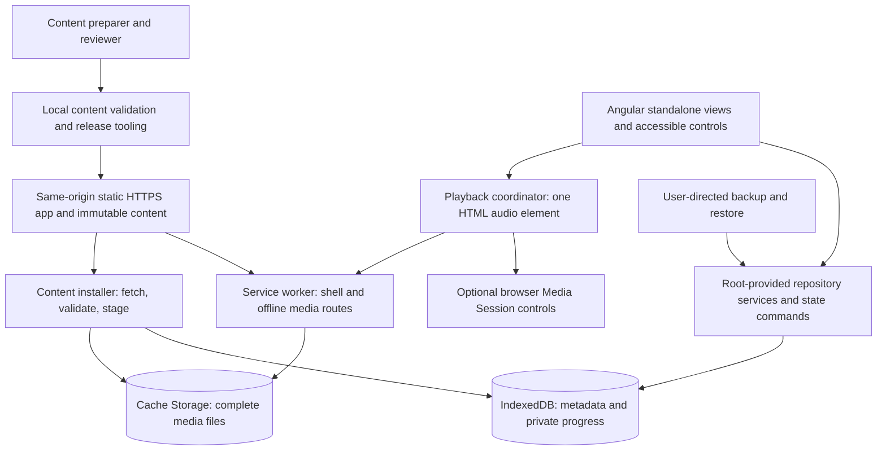
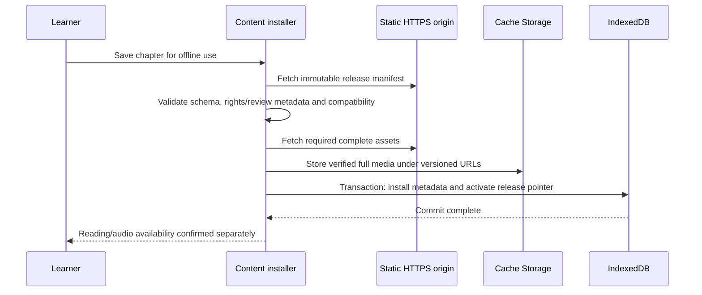

# ShrutDhara — web application design

Draft 0.2 · 2026-11-20 · Design only, no production implementation or publication

Revision 0.2: owner selected Angular in place of the earlier React proposal (D-03). Updated UI state, service lifetimes, build tooling, service-worker integration, and implementation slices. Behavioral and device-validation gates remain open.

## Recommendation and decision standing

Build a **static, installable progressive web app (PWA)**, with **Angular + TypeScript**, standalone components, signals, root-provided application services, IndexedDB for content metadata and personal state, a persistent HTML audio player, and a custom Workbox service worker for offline assets and range-aware audio. Use Angular CLI for builds. Host application and content on one stable HTTPS origin. No required application backend, account system, cloud database, paid API, APK, or store listing.

Web-only delivery is the owner's confirmed D-02 decision. Android phones remain the primary audience (D-01), and Angular is the confirmed framework choice (D-03). The detailed mechanisms below remain design recommendations where not otherwise accepted. The prior native Kotlin/Compose recommendation and React/Vite proposal are superseded.

Installable web apps do not require us to distribute a custom executable or publish a store package; installation remains browser/platform dependent. The app must also work through a normal URL without installation. [Web platform installation guidance](https://web.dev/learn/pwa/installation).

The decision-changing uncertainty is **real mobile-web listening**, not component rendering. Before building the whole app, prove actual offline audio, seeking, screen-off continuation, and media controls on intended Android phones. A PWA manifest and a simulated player do not prove these guarantees. If the selected browser fails the listening acceptance gate, stop dependent listening investment and bring back the precise failed condition; do not silently substitute native delivery or weaken the requirement.

## Inputs, current system, and scope

Behavioral authority: [use-case specification v0.2](use-case-specification.md), including its single gap register and rules R-01–06. Rationale: [analysis findings](analysis-findings.md). Reusable visual direction and bounded browser evidence: [prototype review](prototype-review.md).

Current implementation is the disposable `prototype/` HTML/CSS/JS application, served by `prototype/server.mjs`. `prototype/state.mjs` validates demonstration state; `prototype/app.js` uses localStorage and a simulated timeline. There is no real narration, service worker, PWA installation, production content repository, or IndexedDB store. Its five state tests and browser observations cannot verify the proposed components. Retain the prototype for comparison; do not treat its DEMO identifiers or browser-local backup format as scripture identity or production persistence.

Preserve the paper/olive/saffron palette, Mukta interface font, Noto Serif Devanagari reading default, Hindi content, and balanced English utility labels. Reuse licensed local font files and notices. Reader gesture behavior, first chapter/source, review authority, and licensing decisions remain in G-02/03/04/09. The design does not close them.

Proposed first product increment: one shared complete chapter for reading/listening, sources and component availability, independent resume, bookmarks, explicit offline preparation, and export/restore. First online access is needed to obtain the app/content; an offline return works only after preparation succeeds and browser storage remains available. The full collection, advanced search, editable multi-chapter queue, and later content distribution receive bounded extension contracts below, not an invented v1 commitment (G-10).

## Alternatives at the actual boundary

| Choice | Fit and trade-off | Decision |
| --- | --- | --- |
| Angular + TypeScript PWA | Standalone components, signals, routing, and dependency injection give the reader, repositories, and player explicit responsibilities. Adds framework conventions and a build step; does not improve browser background permissions. Existing visual assets carry over. | Owner-selected framework, D-03. |
| Extend existing vanilla JS with TypeScript and PWA support | Lower initial conversion effort; whole-page template replacement would still need restructuring for focus, state, and player lifetime. | Not selected following D-03. |
| React + TypeScript + Vite PWA | Technically viable; composition and shared state fit both journeys, but require different lifecycle/build conventions. | Earlier proposal superseded by D-03; no React implementation exists to migrate. |
| SSR/full-stack framework | Would add server and deployment concerns without an account, personalized server data, or required server rendering use case. | Omit unless a later concrete requirement needs it. |
| Native app or native wrapper | Would reopen package/distribution scope rejected by the owner. | Excluded by D-02. |

Use Angular signals/computed values for rendered and transient state, with repository snapshots for persistent state. Root-provided services own playback, content, personal-state commands, and backup coordination. Use RxJS where event-stream composition is useful; do not add NgRx or a separate state framework initially. Signal effects must not become a second persistence writer. Use the small `idb` wrapper rather than handwritten callback-heavy IndexedDB plumbing; transactions still enforce the guarantees. Pin compatible dependency versions and retain a lockfile when implementation begins. [Angular standalone components](https://angular.dev/guide/components), [signals](https://angular.dev/guide/signals), [idb](https://github.com/jakearchibald/idb).

Use Angular CLI's client-rendered application build with no SSR/server requirement. After the production build, compile the custom service-worker source and run Workbox `injectManifest` against the configured browser output directory. Include the shell, lazy route chunks, and local fonts in the generated precache manifest; exclude chapter audio from automatic precaching. Register that single worker from application bootstrap on the production HTTPS origin (or localhost for development validation). Do not use the Vite PWA plugin, add a Vite build, or register Angular's default worker alongside it. Angular describes its own service worker as a basic caching utility with a limited feature set; our custom worker owns advanced media caching, update coordination, and ranges. [Angular service-worker scope](https://angular.dev/ecosystem/service-workers), [Workbox build/injection](https://developer.chrome.com/docs/workbox/modules/workbox-build).

Keep the app shell and mini-player outside the routed view. Lazy-load collection, reader, listening, bookmarks, and settings screens where useful. Provide the playback service at the application root, never again in route/component providers: route navigation must not recreate the player. Expose read-only signals to views and explicit command methods for writes; retain the repository/IndexedDB commit boundary for saved feedback. Preserve the custom CSS/tokens and font direction rather than introducing a component-library visual redesign. Use semantic HTML and accessible native controls first; Angular CDK utilities may be added for a concrete accessibility need.

## Components, ownership, and trust

| Component | Responsibility / authoritative writer |
| --- | --- |
| Standalone views and signal-based view state | Angular Router navigation, focus, accessible controls, loading/missing/error states. Render read-only repository/player signals; never assert saved/downloaded/playing merely because a command was sent. |
| Content repository | Resolve active releases, stable identities, order, component review/rights evidence, and actual local availability. No runtime generation of scripture or translation. |
| Personal-state repository | Sole API for progress, bookmarks, preferences, restore epoch and write revisions. IndexedDB transaction completion is the local save boundary. |
| Root-provided playback service | Own one audio element outside route components. Resolve local asset, play/pause/seek/speed/queue, handle real media events, serialize listening writes, expose the mini-player. Route/component destruction must not destroy the player; application shutdown releases its listeners and playback ownership. Separate browser windows still require the Web Lock boundary below. |
| Service worker | Cache application shell/fonts, provide offline navigation fallback, and serve cached audio ranges. It does **not** own a long-running audio player, personal progress, or a dependable sleep alarm. |
| Content installer | Own staged download jobs, size/hash/schema validation, cache writes, release activation, reconciliation, and cleanup. It cannot certify doctrine or license validity. |
| Backup coordinator | Validate user-selected exports before mutation; acquire maintenance ownership, stop stale writers, then restore personal stores atomically. |
| Editorial tooling | Own authored source/reference records, reviewer evidence, script coverage, license notices, immutable release IDs, corrections, and reference mappings. No in-app editorial account system is required. |

Untrusted inputs include content downloads, backup files, URLs, and external media commands. Validate data at entry. Render scripture/explanations as structured text blocks, never untrusted HTML. No executable content in packages. Allowlist same-origin content paths, reject path traversal, enforce schema/byte limits, and verify declared asset digests. A hash detects mismatched bytes; it does not establish that a reviewer is qualified or that the hosting origin is uncompromised.

The device/browser profile is the private-state boundary. There are no app roles or cloud accounts. Do not add analytics, remote fonts, third-party scripts, or automatic progress uploads. A user may save an exported backup to a cloud-synced folder; disclose that the destination is their choice rather than promising the export stays device-only.

## Persistent model and internal contracts

Use one IndexedDB database with explicit schema versions and transactions. Keep media bytes in a separate, application-owned Cache Storage namespace. These stores are not one atomic transaction; the installation protocol below handles that boundary.

| Record / key | Minimum design contract |
| --- | --- |
| ContentRelease / immutable releaseId | Schema version, minimum reader capability version, release digest, component list, correction notes, and optional reviewed reference mappings. Same releaseId with different bytes is rejected. |
| Work, edition, chapter, sutra / opaque stable IDs | Explicit relationships and ordering; edition-specific authentic references and source citations are attributes. IDs are assigned in editorial records and do not derive from a display number, translated title, array index, or filename. |
| ComponentRevision / immutable revisionId | Kind: original, translation, explanation, narration script, or recording; language, source evidence, attribution/license evidence, review scope/status, and structured blocks or asset references. Review status is separate from local availability. |
| InstalledAsset / asset digest | Versioned URL, expected bytes/digest, media type, part ID, local state, and owning release. `ready` requires a verified complete cache entry. Recheck existence before use because the browser/user may remove storage. |
| ActiveRelease / collection scope | Pointer changed transactionally only after required content components are validated. Old active pointer survives failed installation. |
| ReadingPosition / journey key | Stable sutra ID, edition/component revision, text-block anchor and character offset, fallback block/viewport offset, record revision, and timestamp. Prefer semantic anchors to page pixels when fonts change. Exact policy remains G-04. |
| ListeningPosition / journey key | Chapter ID, recording revision, part ID, position in milliseconds, rate, and last committed checkpoint. A replacement recording does not inherit a timestamp without a valid mapping. |
| Bookmark / stable sutra ID | Reference to content identity plus a display snapshot for unresolved material. No cascade deletion when content becomes unavailable. Duplicate add is idempotent; remove uses explicit identity. |
| Preferences and prepared queue | Reading font/size/theme/visibility; ordered recording/part references and autoplay selection. Preserve order and repeated queue items with their own entry IDs. |
| StateMeta | Personal schema version, restore epoch, and writer/session revision guards. Stale async events cannot overwrite a completed restore. |

Suggested internal boundaries: `getChapterAvailability`, `resolveReadingAnchor`, `saveReadingPosition(expectedRevision, epoch)`, `setBookmark`, `prepareOfflineRelease`, `prepareQueue`, `checkpointListening`, `exportSnapshot`, and `restoreValidatedSnapshot`. These are TypeScript modules, not HTTP endpoints. Commands return a result such as committed, unavailable, incompatible, conflict, storage-full, or cancelled; the UI maps these to the actual supported recovery.

Do not copy the prototype localStorage JSON into these stores automatically. Offer an explicit demonstration-data reset/omission; production import accepts only a defined production export schema. Propose JSON backup v1 containing both journey positions, bookmarks, preferences, queue references, and source/revision identities, excluding audio bytes and licenses already carried with content. Unresolved IDs remain recoverable records, not discarded entries. Replace-versus-merge and inclusion of queue/preferences need G-12 acceptance before restore implementation.

Search, when included, builds a local derived index over installed text and authoritative references; topic labels must be editorially supplied. Normalize only the index/query representation and preserve original Unicode text. Never claim to search unavailable content. Select the indexing mechanism after a representative chapter and corpus size exist, rather than inventing a server search requirement.

## Reading and listening execution

**UC-03 reading:** a view resolves a verified available component set through the content repository, renders stable block keys, and restores an anchor after font/layout readiness. Reader actions update only ReadingPosition and bookmarks through the state repository. Show bookmark success after transaction completion. On storage failure preserve the visible passage, report that the change was not saved, and offer backup/retry where viable. The anchor fallback must be visible when a correction prevents exact recovery; do not claim exact resume across changed text. Gesture exploration remains G-04; architecture supports a scrollable sutra with either explicit transitions or a tested gesture adapter.

**UC-04 listening:** after a user gesture, resolve the exact recording revision and local asset, set the audio source, load metadata, validate/clamp a compatible checkpoint, seek, then request playback. Only actual media events establish playing/paused/error/ended. Keep the player mounted across routes. Update position from `currentTime`, not a wall-clock simulation. Save on pause/seek completion, part transition, and observed visibility/media events; use periodic checkpoints during active playback as a best effort. Propose a two-second foreground checkpoint interval for the capability experiment, not a guaranteed maximum loss after browser termination. G-04 must settle the acceptable persistence behavior.

Playback can be denied by browser policy; handle the rejected `play()` promise and offer an explicit play action without pretending audio began. Never automatically start audible playback merely on reopen. [HTMLMediaElement.play](https://developer.mozilla.org/en-US/docs/Web/API/HTMLMediaElement/play).

**UC-05 prepared listening:** preflight every selected part for availability, revision, and complete local cache presence. Do not require a missing-file choice while the person is driving. The queue is frozen for the session; newly downloaded/replaced content does not change it underneath playback. An unavailable next item stops the journey with a clear status; skipping a known gap requires an accepted G-07 rule. Part-to-part continuation belongs to the same chapter. Never mark a chapter understood merely because the player reached its end (G-08).

Register Media Session metadata and individually supported actions after feature detection; all commands go through the same coordinator and allowlisted media IDs. Unsupported actions retain in-app controls. The API enables OS-level media interaction where supported but has incomplete cross-browser availability. It does not promise Android Auto integration or every steering-wheel control. [Media Session API](https://developer.mozilla.org/en-US/docs/Web/API/MediaSession).

For interruptions, observe pause/error/routing-related events exposed by the browser. Proposed policy: remain paused after interruption and let the user explicitly resume; do not claim the web app can identify every phone call or audio-focus change. Sleep timer uses an absolute deadline, checked on playback events and when the document becomes active, with a foreground timeout as an aid. Browser suspension can delay execution; exact background timer expiration is not promised and must be evaluated under G-14.

## Offline acquisition and release activation

The first successful install obtains the shell and reviewed first-chapter text; audio is an explicit save action if its size warrants it. Do not hide a failed media download behind a successful PWA installation badge. Installed mode is optional; offline readiness is its own state.

Download full media responses before marking them ready. Partial streamed responses are not proof of an offline file. The service worker serves valid byte ranges from full cached media so offline seeks work. Use Workbox range handling and media CORS settings even for same-origin audio as its guidance requires. [Cached audio/video guidance](https://developer.chrome.com/docs/workbox/serving-cached-audio-and-video), [range handling](https://developer.chrome.com/docs/workbox/modules/workbox-range-requests).

Installation state: absent → staging → verified → ready; failures expose retry/cancel without changing the active release. Fetch and hash work happens outside IndexedDB write transactions. A short activation transaction records metadata and the pointer only after cache writes finish. If the process stops before commit, the old release remains active and new assets are harmless orphans. If it stops after commit, the new pointer is authoritative. On next launch reconcile asset presence; storage loss changes availability to missing rather than claiming offline playback works. Retrying the same release/digest is idempotent. Conflicting digests or unsupported schema do not activate.

Use immutable content URLs and retain the currently playing recording, active release, and any unresolved personal references during cleanup. Garbage collection may remove only unreferenced assets; serialize cleanup with install/playback ownership so it cannot delete a just-selected source. A storage-full error aborts the new installation; do not automatically delete personal state or old usable content to make room. Request an estimate and optionally persistent storage in context, but handle rejection. Browser storage is best-effort unless persistence is granted, and explicit site-data removal can still erase it. [Storage limits/eviction](https://developer.mozilla.org/en-US/docs/Web/API/Storage_API/Storage_quotas_and_eviction_criteria), [persistence request](https://developer.mozilla.org/en-US/docs/Web/API/StorageManager/persist).

Do not cache all 32 Agamas' audio automatically. Estimate each download from its manifest. Illustration only: a one-hour 64-kbit/s recording is about 28.8 MB before metadata/overhead (`64,000 × 3,600 / 8`). The actual format, bitrate, duration, storage threshold, and long-chapter part sizes need measurement with reviewed audio. Whole-response range processing may use significant memory; the first device gate must include the largest proposed part. If it fails, reduce encoded part size or choose another measured media-storage mechanism before expanding the catalog.

If the entire origin's storage, including the app shell, has been removed, an offline launch may fail before the application can display a recovery screen. Reacquire the app online and restore a user-held backup; a service worker cannot recover data that has itself been erased. Partial asset loss can be explained inside the app only when the shell still loads.

For initial delivery, content is built and reviewed locally and published as static files. Later automated download/retry scheduling is optional; do not introduce background-sync guarantees or download-service infrastructure now.

## Consistency, restore, and failure ownership

| Boundary | Mechanism and required observable outcome |
| --- | --- |
| Concurrent player tabs/windows | Use an exclusive same-origin Web Lock for playback ownership on the declared support baseline. Secondary tabs do not create competing players; offer a handoff request. Do not steal a lock merely because a background heartbeat was delayed. If the owner cannot respond, explain that the other window must stop/close. Unsupported locking requires an explicitly bounded fallback before support is claimed. [Web Locks](https://developer.mozilla.org/en-US/docs/Web/API/Web_Locks_API). |
| Concurrent personal writes | IndexedDB transactions check record revision and restore epoch. Reading views carry a session generation; stale views cannot overwrite newer ownership. BroadcastChannel can notify views, but transaction checks enforce correctness even when messages are delayed. Exact cross-tab handoff copy/behavior is G-13. |
| Save feedback vs commit | Serialize repository mutations; only committed transactions report saved. Bookmark add/remove is identity-based and retry-safe. Listening events from an older recording/session are rejected after a switch. |
| Restore vs live audio/other tabs | Fully parse/validate/migrate backup in memory, acquire a maintenance lock, require current playback to pause/release ownership, then replace approved personal stores and advance epoch in one transaction. All writers check epoch; pending old checkpoints are rejected. No partial merge or partial restore. Failed validation leaves state untouched. G-12 owns the accepted replace/merge policy. |
| Export vs failed download/file save | Create a consistent read snapshot and a browser download Blob with no content bytes. Say export prepared, not safely backed up, because successful retention at the chosen destination cannot always be observed. File input restores are user-selected; do not require File System Access API support. |
| Missing content in a backup | Preserve its identity/snapshot and label it unavailable. Restore does not import unverified scripture or silently navigate elsewhere. Compatible content can later resolve the record. |
| Incompatible source/recording correction | No timestamp reuse based only on chapter title. Preserve old position/revision and offer reviewed mapping or explicit restart; do not discard the old record. Acceptance remains G-05. |
| DB schema upgrade | Versioned IndexedDB upgrade, tested against old fixtures. Other windows close connections on version change; blocked upgrade shows a recoverable close-other-window message. No destructive fallback. Failed upgrade does not delete the old DB. Do not await network or unrelated promises inside a transaction; `idb` documents transaction lifetime limitations. |
| Browser closes/kills app | Playback ends; next launch restores last committed checkpoints and stays paused. A service worker cannot guarantee continued playback or final checkpoint execution after termination. |
| Site storage cleared or origin changed | Personal data may be gone. Manual backup is the recovery path. A new origin is a separate installation/data boundary; retain a stable production origin and provide an export/restore move if it changes. |

Multi-tab and restore safeguards are technical proposals preventing lost state, not permission to choose undisclosed product conflict policies. Their owner decisions remain in G-12/G-13.

## Application updates, hosting, and operating cost

Precache the shell and local fonts; use navigation fallback only for app navigations, never return HTML for missing JSON/audio. Separate shell cache revisions from immutable content caches. A waiting service worker advertises an update; defer reload/activation while reading state is uncommitted, playback is active, or backup/restore is in progress. Do not unconditionally call skipWaiting/clientsClaim and replace a playing app. All windows must participate in an update handshake; an unresponsive playing window delays activation. Keep old hashed assets available through the supported upgrade window.

An app release declares supported content/backup/database versions. An old client must not activate new incompatible content. Database migrations should be additive where possible; rolling back static HTML/JS does not undo a database upgrade. Release recovery is a forward-compatible fix or a tested compatible previous build, not deleting local state. Test old-client/new-content and new-client/old-content combinations before publishing.

Deploy to a static HTTPS host with a stable origin, correct audio/font/JSON MIME types, immutable asset URLs, conservative manifest/service-worker caching, and appropriate security headers. No provider is selected and no deployment is authorized by this design task. Preview and production should use separate origins to keep test data/service workers out of production.

The app requires no per-user backend compute or paid runtime API. Hosting bandwidth, audio production/review, domain renewal, and provider limits are not proven free. A free static-host plan may fit personal use after checking actual media size, traffic, and terms; this document makes no perpetual zero-cost guarantee. Do not create a hosting account or introduce a paid service without the owner's choice.

Use local diagnostics for content/schema/install/media errors, with bounded retention and no study history in ordinary logs. Any support export is user initiated and previewable; no background telemetry service is needed.

## Validation gate and coherent implementation increments

**P0 — web capability experiment, before the full UI conversion.** On actual intended Android phones, test the same real audio in a normal browser tab and an installed PWA: user-initiated play, complete local save, network disabled, cold return, range seeking, speed, background screen-off playback, next part, media buttons, phone interruption, route disconnect, storage denial/quota failure, and largest proposed audio part. Close/force-stop behavior is checked as a recovery boundary, not uninterrupted-playback support. Exercise a sleep deadline while backgrounded and record delay. Record exact device/browser versions, codec, asset size, and passed/failed conditions. G-01/G-04/G-07/G-14 define acceptance. No device experiment was executed in this design task.

Use a rights-cleared ordinary spoken-audio fixture if reviewed scripture is not available for the technical experiment; clearly label it and never use it to claim chapter quality. The actual learning validation still needs reviewed material. A failed screen-off or offline-seeking test blocks claiming the corresponding listening flow; it does not block reader work.

**P1 — durable offline reader.** Create the Angular CLI application separately (proposed `web/`), preserve the prototype, establish standalone routed components/root-provided services/read-only signal state, and implement shell/fonts/content repository/IndexedDB, one approved chapter, provenance, semantic resume, and bookmarks. Configure the post-build custom Workbox worker and verify lazy route chunks load offline. Demonstrate refresh/reopen offline and failed-save recovery. Resolve G-04's gesture/anchor behavior with actual touch testing.

**P2 — real local listening.** Integrate the proved root-provided playback service with actual chapter audio, separate checkpoints, queue preflight, mini-player, supported Media Session actions, and safe missing-content stops. Test repeated Angular route changes and view recreation without a second audio element or duplicate event listeners. No fabricated narration or script recitation substitution. Retest the P0 behaviors with the actual chapter file/parts.

**P3 — preservation and safe updates.** Implement defined export/restore, schema migration fixtures, content replacement mappings, staged release activation, multi-tab conflict handling, quota recovery, and waiting-worker update behavior. Prove crash/abort points before and after cache writes and metadata commit. No production content update or restore feature ships before its corresponding contract is settled.

**P4 — learning/accessibility and release preparation.** Observe intended readers using real Hindi text and a complete narration; compare the selected font at sustained reading sizes. Check contrast, focus order, language metadata, screen-reader announcements, large type, and touch targets. Select measurable opening/resume targets on declared devices (G-11). Prepare reviewed content/license notices and an owner-reviewable deployment candidate. Publishing remains a separate owner-authorized action.

## Design handoff and readiness

The design is coherent for an Angular browser-first implementation and a bounded capability experiment. Angular and web delivery are accepted choices; remaining mechanism proposals and existing product gaps have not been rewritten as implementation approval. The specification remains the source for behavior and the gap/decision register, including D-03 and web gaps G-13/G-14.

Primary-source documentation was checked on 2026-11-20 for installation, caching/ranges, storage persistence, browser playback, locking, and the proposed tooling. Documented API capability is not executed device evidence. This was an author self-review; no independent reviewer or production implementation review was performed.

Ready to start: P0 planning/fixture preparation and independent reader architecture work. Blocked claims: guaranteed mobile background listening, precise crash-resume loss bounds, indefinite local retention, and production content authenticity/rights. Their specific acceptance/evidence gates are G-01/02/03/04/14, not a reason to add a native wrapper.
