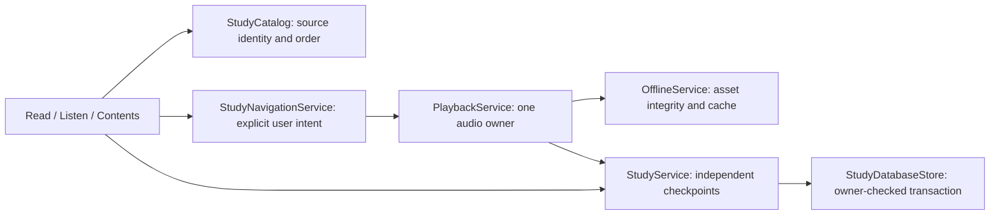

# Sutra study: implementation design

22 November 2026 · Owner authorized app changes after the [journey plan](sutra-journey-change-plan.md).

## Chosen design

Keep Angular, IndexedDB, the existing single study owner, shared HTML audio player, offline integrity cache and Workbox lifecycle. Add a source-aware catalogue and explicit navigation coordination. Do not create a second meaning player or synchronize reading progress to playback. A timestamp is meaningful only within a recording revision; a sutra ID is meaningful only within its source edition.

The alternative of cutting the old commentary into smaller clips was rejected: clipping cannot turn commentary into faithful individual meanings. A separate player per page was rejected because it would duplicate ownership, offline and media-session responsibilities. No framework, backend or generic inheritance hierarchy is needed.

## Objects and responsibilities

| Object / boundary | Responsibility and contract |
| --- | --- |
| `StudyCatalog` domain object | Parses the fixed source document, validates edition/numbered bounds and duplicate meanings, owns ordered `StudySection`/`Sutra` values and exact-ID lookup/adjacency. A missing reference resolves to null, never a nearby unit |
| `parseMeaningRecording` trust boundary | Accepts only a consecutive source prefix with matching revision, stable IDs, approved local paths, positive durations/bytes and SHA-256 metadata. A gap rejects the sequence instead of silently autoplaying across it |
| `ContentService` repository | Loads the source document and recording manifests. Meaning audio, earlier commentary and calibration are distinct recordings. Unknown recording IDs resolve to null. Reader content remains available when audio is missing |
| `StudyNavigationService` application coordinator | Retains transient contents/collection context and identifies the currently displayed listening unit. Coordinates an explicit Play request through catalogue mapping and the existing player. Browsing and deep-link selection do not seek audio |
| `PlaybackService` media owner | Owns one audio element, recording selection, pause/seek, two-second checkpoints, source-part handoff and Media Session. Reuses existing offline verification; stops at the sample boundary. Rejects missing recording switches before replacing the old one |
| `StudyService` / `StudyDatabaseStore` | Sole durable writer behind existing session ownership and serialized transactions. Maintains independent reading/listening plus retained positions per recording. No guessed timestamp migration |
| `SutraReader`, `SutraListen`, `Study` | Render goal-specific states and delegate domain decisions. Shared `StudyContext` renders source location; pages own controls, availability, focus/context and error presentation |

These are composition boundaries with real responsibilities. The implementation deliberately avoids abstract base pages, a generic workflow engine, or inheritance between text and audio simply because both refer to sutras.

## Representative flow

1. A person opens `/read/:id`. `StudyCatalog.find` resolves the source identity. Missing meanings remain navigable references with a pending state. The page saves only reading location and exposes exact-ID Listen when that unit has audio.
2. Opening `/listen/:id` selects what is displayed, without starting or seeking the player. Explicit Play resolves its exact audio index through `StudyNavigationService`.
3. Switching recordings checkpoints the old recording before detaching. `StudyService.saveListening` keeps both the outgoing and incoming recording positions. No old section timestamp is mapped to a new sutra.
4. The shared player prepares verified cached audio or streams that recording's local asset, seeks to its own position, and plays. An unavailable unit never substitutes another track.
5. Automatic handoff updates the displayed sutra and Hindi meaning through the active player's source ID. The mini-player is suppressed only when the same unit is already displayed. Reading another unit continues audio with a persistent return control.
6. The last sample unit stops. Next sutra opens the following source reference with pending text/audio; it does not leap to available content elsewhere.

Pausing before adjacent navigation preserves the prior position. Selecting the next audio unit while paused leaves it paused; active listening continues across an available explicit next/previous selection. Replay explicitly starts the displayed unit at zero. Rate/seek operations use existing ownership checks.

## Preservation and recovery

- Database name stays `shrutdhara-v1`; schema version advances from 1 to 2 without rewriting or deleting the personal store. This version fence is necessary because older app validators would otherwise discard the new retained-position map when writing. Old connections are asked to close through IndexedDB's existing version-change handler. Version-1 application clients cannot reopen the upgraded database as version 1.
- Portable backup v2 includes retained recording positions. V1 backups remain importable; unknown references remain preserved. Old app versions reject v2 backups instead of silently dropping the retained positions.
- No bulk migration of fixture reading, earlier commentary, IDs, timestamps or bookmarks. Explicit legacy routes retain access. New installs start on the new source; existing saved references stay unchanged until the learner selects something.
- Reader callbacks carry a restoration generation so old font/animation callbacks cannot restore a previous sutra after navigation. Valid long-text anchors restore within their block; an untouched opening shows the heading/context rather than scrolling straight past it.
- Audio identity includes a revision-specific recording ID and distinct asset URLs. Replacement content must get a new ID/URL revision. A missing saved audio part shows an unavailable reference with contents recovery; it cannot become “Sutra 1.1.1” silently.
- Safe update remains browser-managed: visible waiting-update notice, explicit preparation in Settings, checkpoint/pause and close/reopen. No forced activation, skipWaiting, storage clearing or automatic page reload is introduced. Actual old-install update recovery still needs a release-candidate/device check.

## Bounded editorial increment

The catalogue contains all 48 numbered units across seven uddeshakas in Jacobi's 1884 structure. It does not claim these numbers are universal across Prakrit editions. Seven first-uddeshaka Hindi drafts and per-unit Piper Pratham MP3s form the review sample; the other 41 meanings/audio are pending, visibly.

The first-number marker missing from the Wikisource transcription was cross-checked against the [Sacred Texts transcription](https://sacred-texts.com/book/jaina-sutras-part-i/book-i-lecture-1-lesson-1), which identifies the opening address as (1), directions as (2), and knowledge/belief/passages through (7). The generated sample was corrected before validation. Each spoken unit includes its reference; first audio discloses synthetic speech. `study.json` keeps source/review notes, `manifest.json` keeps asset metadata/model digest, and `transcript.txt` is the exact spoken wording.

The 1884 English text is the intermediary; no modern Hindi scan or digital Prakrit transcription was copied. Original Prakrit, qualified meaning/pronunciation review and owner listening acceptance remain required before expanding final narration. The local sample is not editorial approval. Credits retain the Pratham training-lineage noncommercial/share-alike notice.

## Verification and continuation

The verification report owns executed results and candidate identity. Unit tests cover source order, gaps, assets/digests, old/new backups and database upgrade preservation/fencing. Real Chrome checks exercise routes, read/listen matching, bookmarks, independent progress, replay/handoff/end, old commentary and offline deep-link reopening. Phone-sized screenshots are layout evidence, not physical Android evidence.

Next: review the sample's meaning, reference alignment, pronunciation and pacing; establish the original Prakrit edition and qualified reviewer; then extend the same source/asset contract to the remaining uddeshakas. Run Firefox/Chrome on the owner's real phone before claiming screen-off, headset, call-interruption or daily-use support. Deploy only on explicit release authorization.
